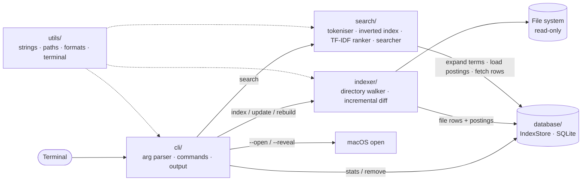

# FileSearch
   [](https://github.com/AmruthaVarshini111/filesearch-cpp/actions)
**A fast, offline file search engine for your Mac, written in C++20.**

FileSearch scans the folders you choose, stores file names, paths, sizes and
modification times in a local SQLite database together with an **inverted
index**, and answers queries from the command line in milliseconds, ranked by
**TF-IDF**. No cloud, no network, no background daemon, and it only ever
*reads* your files.

```text
$ filesearch search "machine learning" --type pdf
1  machine-learning-intro.pdf  (45 B, 2026-11-08 17:40)
   /Users/you/demo/sample/documents/machine-learning-intro.pdf

1 result in 0.1 ms
```

## Contents

- [Features](#features)
- [Install](#install-macos)
- [Usage](#usage)
- [Terminal demo](#terminal-demo)
- [How it works](#how-it-works)
- [Architecture](#architecture)
- [Build and test](#build-and-test)
- [Performance](#performance)
- [Limitations](#limitations)
- [Roadmap](#roadmap) · [Contributing](CONTRIBUTING.md) · [License](LICENSE)

## Features

**Indexing**
- Recursive scan of any number of directories; file name, full path, extension, size and mtime are stored.
- **Incremental**: re-running `index`/`update` skips unchanged files (same size and mtime), adds new ones, refreshes changed ones and drops deleted ones.
- Hidden files are opt-in (`--hidden`); `--exclude` skips names or globs such as `node_modules` or `*.log`.
- Symlinks are safe: directory links are not followed by default; with `--follow-symlinks` every directory is entered at most once, so loops terminate. Broken links are skipped.
- Unreadable directories (permissions) are reported as warnings, never fatal, and their existing entries are never deleted.
- Live progress line on a terminal; Ctrl-C stops cleanly and keeps the work done so far.
- No duplicates: the full path is a unique key, so overlapping roots are fine.

**Search**
- Inverted index (term → postings) with hash maps; TF-IDF ranking with field weights (file name counts more than directory names).
- Case-insensitive; multiple keywords (AND by default, `--any` for OR); exact file name (`--exact`); partial matching (prefix, and substring from 3 letters); camelCase aware (`SearchEngine.cpp` is found by `search engine`).
- Filters: extension, directory, min/max size, modified after/before; `--name-only`.
- Sorting by relevance, size, date or name; `--limit`; `--json` and `--paths-only` for scripting.

**Storage and safety**
- Single SQLite file (WAL mode), batched transactions, indexes on all filtered columns.
- A missing database gives a helpful message; a corrupted one is detected and moved aside by `rebuild` (never deleted).
- `--open N` opens a result with the default app; `--reveal N` shows it in Finder. Programs are started directly, without a shell, so odd file names cannot inject commands.
- FileSearch never deletes, modifies or moves your files (a unit test checks that indexing leaves files byte-for-byte and mtime-for-mtime unchanged).

## Install (macOS)

Requirements: Xcode command line tools (`xcode-select --install`) and CMake (`brew install cmake`). SQLite ships with macOS.

```bash
git clone https://github.com/AmruthaVarshini111/filesearch-cpp.git filesearch
cd filesearch
./scripts/install.sh              # builds in ./build and installs to ~/.local/bin
```

No administrator rights are needed. If `~/.local/bin` is not on your `PATH`, the script prints the exact line to add, or run it with `--add-to-path` to append a marked block to your shell profile:

```bash
./scripts/install.sh --add-to-path
source ~/.zshrc
filesearch help                   # works from any directory
```

Other options: `--prefix DIR` (install elsewhere, e.g. `--prefix ~` for `~/bin`) and `--run-tests` (build and run the unit tests first; needs GoogleTest, which is downloaded automatically if it is not installed).

**Uninstall**

```bash
./scripts/uninstall.sh                 # removes the binary and the PATH entry the installer added
./scripts/uninstall.sh --purge-data    # also deletes the index database (asks first)
```

The database lives in `~/Library/Application Support/FileSearch/index.db`. Set `FILESEARCH_DB` or pass `--db <path>` to use another location.

> **macOS privacy note:** macOS protects folders such as Desktop, Documents, Downloads and Library. If `index` reports "Operation not permitted", grant your terminal app **Full Disk Access** in *System Settings → Privacy & Security*.

## Usage

```bash
filesearch index ~/Documents ~/Projects      # build / refresh the index
filesearch search "machine learning" --type pdf
filesearch search resume --directory ~/Documents
filesearch search report --min-size 1MB --sort size
filesearch search notes --modified-after 2w --open 1
filesearch stats
filesearch update                            # re-scan every indexed directory
filesearch remove ~/Projects                 # forget a directory (files untouched)
filesearch rebuild                           # drop and re-create the index contents
filesearch help [command]
```

### Commands

| Command | Purpose |
|---|---|
| `index <dir>...` | Scan directories. Options: `--hidden`, `--follow-symlinks`, `--exclude <glob>` (repeatable), `-q`, `--no-progress` |
| `search <query>` | Search the index (see below) |
| `stats` | File count, total size, terms, postings, top types, database size, indexed roots. `--verify` runs SQLite's integrity check |
| `update` | Incremental re-scan of all roots using the options they were indexed with |
| `remove <dir>` | Remove a directory from the index |
| `rebuild` | Clear and re-scan; moves a corrupted database aside |
| `help [command]` | Help |

### Search options

| Option | Meaning |
|---|---|
| `-t, --type <ext>` | Extensions, e.g. `pdf` or `pdf,docx` (repeatable) |
| `-d, --directory <dir>` | Only files below this directory |
| `--min-size`, `--max-size` | `500`, `10KB`, `1MB`, `2GB`, `1MiB` (KB/MB/GB are decimal, as in Finder) |
| `--modified-after`, `--modified-before` | `2024-01-31`, `today`, `yesterday`, or an age: `12h`, `7d`, `2w`, `3m`, `1y` |
| `--name-only` | Ignore directory names |
| `--exact` | File name must equal the query (`report.pdf`) |
| `--whole-words` | Disable prefix/substring matching |
| `--any` | OR instead of AND |
| `-n, --limit <n>` | Default 20, `0` = all |
| `-s, --sort <key>` | `relevance` (default), `size`, `date`, `name`; `--reverse` flips it |
| `-p, --paths-only` / `--json` / `--score` | Output formats |
| `--open <n>` / `--reveal <n>` | Open / reveal the n-th result |

A query may be empty if a filter is given (`filesearch search --type pdf`). Use `--` before a query that starts with a dash.

## Terminal demo

Real output from `scripts/demo.sh` (it indexes a copy of `tests/sample_data` with a temporary database; paths shortened):

```text
$ filesearch index /Users/you/demo/sample
Indexed /Users/you/demo/sample
  Files     11 scanned: 11 new, 0 updated, 0 unchanged, 0 removed
  Skipped   2 hidden

$ filesearch search machine learning
1  machine-learning-intro.pdf  (45 B, 2026-11-08 17:40)
   /Users/you/demo/sample/documents/machine-learning-intro.pdf
2  machine-learning-notes.txt  (69 B, 2026-11-08 17:40)
   /Users/you/demo/sample/documents/machine-learning-notes.txt

2 results in 0.1 ms

$ filesearch search report --name-only --sort name
1  annual-report.txt  (22 B, 2026-11-08 17:40)
   /Users/you/demo/sample/documents/reports/annual-report.txt
2  budget-report-2023.csv  (29 B, 2026-11-08 17:40)
   /Users/you/demo/sample/documents/budget-report-2023.csv
3  quarterly_report_q1.txt  (25 B, 2026-11-08 17:40)
   /Users/you/demo/sample/documents/reports/quarterly_report_q1.txt

3 results in 0.1 ms

$ filesearch search --type md,cpp --sort size
1  deep_learning_survey.md  (32 B, 2026-11-08 17:40)
   /Users/you/demo/sample/documents/deep_learning_survey.md
2  main.cpp  (25 B, 2026-11-08 17:40)
   /Users/you/demo/sample/code/main.cpp
...
```

In a real terminal, names are bold and paths are coloured (disabled automatically when piped, with `--no-color`, or when `NO_COLOR` is set).

## How it works

1. **Scan**: an iterative directory walk records each file's name, extension, size and mtime.
2. **Tokenise**: the file name and its directory are split into lower-case words (`machine-learning_Notes2024.PDF` → `machine`, `learning`, `notes2024`, `pdf`; camelCase splits too, and the unsplit run is kept so `filesearch` still finds `FileSearch.cpp`). Name and directory are separate *fields*.
3. **Index**: each term gets a posting `(term, file, tf_name, tf_path)` in SQLite; a trigger maintains each term's document frequency.
4. **Query**: query words are expanded to matching vocabulary terms (exact, prefix, substring), their postings are loaded into an in-memory hash-map inverted index, scored with TF-IDF, intersected (AND), filtered, sorted and limited.

Scoring, for query word *q* and file *d*: `match_weight × idf × (3·(1+ln tf_name) + 1·(1+ln tf_path))` where `idf = ln(1 + N/df)`, `match_weight` is 1.0 / 0.6 / 0.3 for exact / prefix / substring, the file-name part is divided by `√(words in name)`, and files get boosts when every query word is in the name (×1.5), the stem equals the query (×2.5) or the whole name equals it (×4). These weights are reasoned heuristics, not tuned on a relevance benchmark. Details are in [docs/ARCHITECTURE.md](docs/ARCHITECTURE.md).

## Architecture



```text
include/ + src/
  cli/        argument parsing, commands, help, open/reveal
  indexer/    Walker + Indexer (incremental sync of disk -> database)
  search/     term extraction, InvertedIndex, ranker, Searcher
  database/   SQLite RAII wrapper, IndexStore (schema, queries, maintenance)
  utils/      string/path/format helpers, terminal styling, error types
tests/        GoogleTest suite + sample_data/
scripts/      install.sh, uninstall.sh, benchmark.sh, demo.sh
docs/         ARCHITECTURE.md, BENCHMARKS.md
```

## Build and test

```bash
cmake -S . -B build -DCMAKE_BUILD_TYPE=Release
cmake --build build -j
ctest --test-dir build --output-on-failure     # 113 tests
./build/filesearch help
```

- SQLite3 is found with `find_package(SQLite3)`; GoogleTest is used from the system if present, otherwise downloaded at configure time (needs internet *only for building tests*). Build without tests: `-DFILESEARCH_BUILD_TESTS=OFF`.
- Sanitizers: `-DFILESEARCH_SANITIZE=ON` (AddressSanitizer + UBSan).
- Tests use private temporary directories and databases; they never touch your files or your real index. The committed dataset in `tests/sample_data/` is copied before use.
- Two tests that need an unprivileged user (unreadable directories) are skipped when run as root.
- `.github/workflows/ci.yml` builds and tests on macOS and Ubuntu.

## Performance

Measured with `scripts/benchmark.sh` on 100,000 synthetic empty files (single-core Linux x86_64 VM, Release build):

| Measurement | Result |
|---|---|
| Full index | 7.4 s |
| Re-index, nothing changed | 0.45 s |
| Search, 2 words (`machine learning`) | 21 ms |
| Search, common word (`invoice`, ~10% of files) | 39 ms |
| Search, 2 words, 1 match (`brand new`) | 12 ms |
| Database size | 75 MB |

Numbers depend heavily on hardware, file system and tree shape; run `./scripts/benchmark.sh` on your Mac for your own figures (see [docs/BENCHMARKS.md](docs/BENCHMARKS.md)). No macOS timings are claimed here.

## Limitations

- Searches **names and paths only**, not file contents.
- The index is a snapshot: run `filesearch update` after files change (no file watcher yet).
- Case-insensitivity covers ASCII letters; other scripts match case-sensitively. Non-ASCII UTF-8 names are indexed.
- Substring matching scans the vocabulary of distinct terms, so it slows down on very large, varied trees; `--whole-words` skips it.
- The directory name is indexed for every file, which makes the database larger (about 750 bytes per file in the benchmark above).
- One writer at a time (SQLite); concurrent readers are fine.
- Size units: `KB/MB/GB` are decimal (like Finder); use `KiB/MiB/GiB` for binary.

## Roadmap

- [ ] Full-text indexing of file contents (plain text, Markdown, PDF)
- [ ] Live updates via FSEvents instead of manual `update`
- [ ] BM25 scoring and a small relevance test-set to tune weights
- [ ] Typo-tolerant matching (edit distance on the vocabulary)
- [ ] Unicode-aware case folding
- [ ] Shell completions (zsh/bash/fish) and a Homebrew formula
- [ ] Interactive TUI picker (`fzf`-style)
- [ ] Config file for default excludes and roots

## License

MIT, see [LICENSE](LICENSE).
